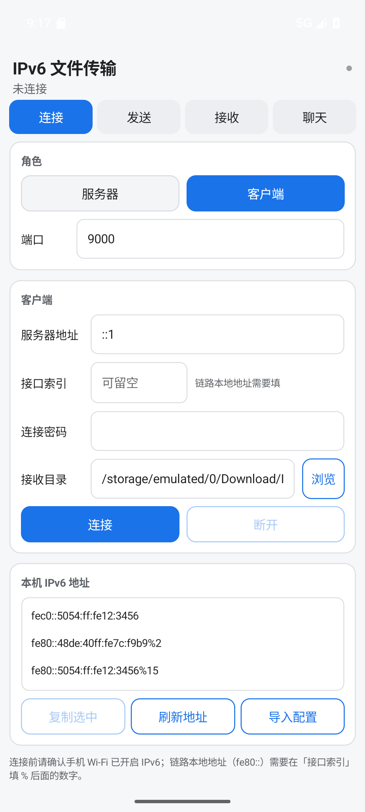

# IPv6 文件传输 · 手机版（C# / .NET MAUI）

> 这是原手机版（Pydroid 3 / Tkinter，现已由本 C# 版取代）的 C# 重写：**界面一致、功能一致、协议完全兼容**。
> 手机可以和电脑、另一台手机（Python 版或本 App）互相传文件、发消息。

| | |
|---|---|
| 框架 | .NET 10 + .NET MAUI |
| 目标平台 | Android（主）、Windows（桌面调试）、iOS / MacCatalyst（同一套代码，需 Mac 构建） |
| 应用 ID | `com.ipv6transfer.mobile` |
| minSdk / targetSdk | 21 / 36 |
| 协议版本 | `PROTO_VERSION = 1`，与 `../PC/file_core.py` 逐字节一致 |

## 交付物

| 文件 | 说明 |
|---|---|
| `dist/com.ipv6transfer.mobile-1.0.1.apk` | **可直接安装的 Release APK**（29 MB，`adb install` 即可） |
| `docs/screenshots/` | 模拟器（Pixel 7 / API 36）实拍截图，共 12 张（含应用图标） |
| `tests/run-interop.ps1` | 对着 python 版跑 25 项协议互通断言 |
| `README.md` | 本文（构建、功能、差异、限制、验证） |

> 同级目录里的 `MauiApp1/` 是最初创建的空模板工程，与本项目无关，可以整个删掉；
> 本项目通过 `Ipv6Transfer.slnx` 管理 `Ipv6Transfer.Core` 与 `Ipv6Transfer.Mobile` 两个工程。




## 1. 项目结构

```
C#/
├─ Ipv6Transfer.slnx                  解决方案（含 Core + Mobile）
├─ Ipv6Transfer.Core/                 协议内核（net10.0 类库，零 UI 依赖，可被任何项目引用）
│  └─ Protocol/
│     ├─ ProtocolConstants.cs          常量、异常、错误分类
│     ├─ FramedConnection.cs           JSON 控制行 + 裸字节帧收发（对应 Conn）
│     ├─ JsonMsg.cs                    紧凑 JSON 编解码 + 安全取值
│     ├─ Handshake.cs                  hello / HMAC-SHA256 挑战应答 / 建连 / 监听
│     ├─ ConnectionConfigCodec.cs      FT6.xxx.checksum 连接串编解码
│     ├─ FileTransfer.cs               send_file / recv_file / list_remote
│     ├─ ServerSession.cs              handle_transfer_session、NameLocks
│     ├─ ControlLink.cs                文字通道（say / notice / push / ping / bye）
│     ├─ FileNames.cs                  安全文件名、唯一名、路径越界校验
│     ├─ Formats.cs                    大小 / 速率 / 时长格式化
│     ├─ ProgressState.cs              进度、EMA 速率、ETA、限速
│     └─ Ipv6Addresses.cs              本机 IPv6 地址枚举与分类
├─ Ipv6Transfer.Mobile/               MAUI App
│  ├─ App.xaml(.cs)                   资源样式、窗口装配、生命周期保存配置
│  ├─ MauiProgram.cs                  字体、Android 输入框去下划线
│  ├─ Views/
│  │  ├─ MainPage.xaml(.cs)           四个页签主界面
│  │  └─ Dialogs.cs                   文件浏览器 / 输入框 / 详情 / 哈希 / 分享 / 导入
│  ├─ ViewModels/
│  │  ├─ MainViewModel.cs             全部界面状态与业务（对应 python MobileApp）
│  │  └─ ObservableObject.cs          INotifyPropertyChanged + 同步/异步命令
│  ├─ Models/Models.cs                传输记录、待发送文件、在线客户端、聊天、地址条目
│  ├─ Services/
│  │  ├─ AppConfig.cs                 mobile_config.json（键名与 python 完全一致）
│  │  ├─ DialogService.cs             模态页面 / 剪贴板
│  │  └─ MobileStorage.cs             跨平台可写目录 + Android 公共存储授权
│  └─ Platforms/Android/              清单权限（All files access 等）
├─ tests/                             与 python 版的互通验证（见第 6 节）
└─ docs/screenshots/                  模拟器实拍截图
```

### Python → C# 对照

| python | C# |
|---|---|
| `file_core.py` `Conn` | `Protocol/FramedConnection.cs` |
| `read_hello` / `authenticate` / `resolve_and_connect` | `Protocol/Handshake.cs` |
| `encode_connection_config` / `decode_connection_config` | `Protocol/ConnectionConfigCodec.cs` |
| `send_file` / `recv_file` / `list_remote` | `Protocol/FileTransfer.cs` |
| `handle_transfer_session` / `NameLocks` | `Protocol/ServerSession.cs` |
| `ControlLink` | `Protocol/ControlLink.cs` |
| `sanitize_name` / `unique_final_name` / `ensure_inside` | `Protocol/FileNames.cs` |
| `human_bytes` / `format_duration` | `Protocol/Formats.cs` |
| `ProgressState` / `RateLimiter` | `Protocol/ProgressState.cs` |
| `list_ipv6_addresses` / `format_address_entry` | `Protocol/Ipv6Addresses.cs` |
| `main.py` `MobileApp` | `ViewModels/MainViewModel.cs` + `Views/MainPage.xaml` |
| `FileBrowser`（Tk Toplevel） | `Views/Dialogs.cs` `FileBrowserPage` |
| 别名 / 哈希 / 详情 / 配置串弹窗 | `Views/Dialogs.cs` 各 Page |
| `mobile_config.json` | `Services/AppConfig.cs`（同名键，两边文件可互换） |

---

## 2. 构建与安装

### 2.1 环境

- .NET SDK 10（含 `android` / `maui-windows` workload）
- Android SDK（platforms 35/36、build-tools 36）
- JDK 21

```powershell
$env:JAVA_HOME='C:\Program Files\Android\openjdk\jdk-21.0.8'
$env:ANDROID_HOME='C:\Program Files (x86)\Android\android-sdk'
$env:ANDROID_SDK_ROOT=$env:ANDROID_HOME
```

### 2.2 构建 Android APK

```powershell
cd D:\MyProjects\IPv6Transfer\mobile\C#
dotnet build Ipv6Transfer.Mobile\Ipv6Transfer.Mobile.csproj -f net10.0-android -c Debug
# 产物：Ipv6Transfer.Mobile\bin\Debug\net10.0-android\com.ipv6transfer.mobile-Signed.apk
```

> **注意**：Debug 默认使用 Fast Deployment，直接 `adb install` 会闪退（`No assemblies found ... Fast Deployment`）。
> 用 `adb install` 安装时请加参数把程序集嵌进 APK：
>
> ```powershell
> dotnet build Ipv6Transfer.Mobile\Ipv6Transfer.Mobile.csproj -f net10.0-android -c Debug `
>   -p:EmbedAssembliesIntoApk=true -p:AndroidEnableFastDeployment=false
> adb install -r --no-incremental Ipv6Transfer.Mobile\bin\Debug\net10.0-android\com.ipv6transfer.mobile-Signed.apk
> ```
>
> 正式分发请用 `-c Release`（默认已嵌入程序集，并做裁剪/AOT）。

### 2.3 桌面调试（Windows）

```powershell
dotnet build Ipv6Transfer.Mobile\Ipv6Transfer.Mobile.csproj -f net10.0-windows10.0.19041.0 -c Debug
```

### 2.4 安装后第一次使用

1. 首次启动若出现「未获得公共存储权限」提示条，点「授权」→ 打开系统「所有文件访问权限」→ 返回 App。
   （未授权也能用，文件会落到应用私有目录，卸载即丢失。）
2. 服务器模式：填端口 → 启动监听 → 回到「连接」页点「分享配置」把连接串发给客户端。
3. 客户端模式：填地址/端口/密码，或点「导入配置」粘贴/选文件导入。

---

## 3. 功能清单（与 python 版逐项一致）

**连接**
- 服务器 / 客户端双角色，切换角色会先停监听、断连接
- 端口、接口索引（链路本地地址用）、连接密码（留空=不验证）
- 服务器：接收目录 + 浏览、启动/停止监听、在线客户端列表、设置客户端别名（按 IP 记忆，双击/按钮进入）
- 客户端：服务器地址、接收目录 + 浏览、连接 / 断开
- 本机 IPv6 地址枚举（全局 / ULA / 链路本地，含接口索引、弃用/临时标记）＋复制选中 / 刷新地址
- 「分享配置」生成 `FT6.` 连接串（含地址、端口、密码）；「导入配置」依次从剪贴板、聊天记录、文件自动识别
- 存储权限提示条（Android 11+ 公共 Download 目录）

**发送**
- 添加文件（内置文件浏览器，可多次添加、去重）、待发送列表、移除选中 / 清空
- 开始上传（客户端）/ 开始发送（服务器，推送给选中客户端或全部）
- 当前任务：进度条、百分比、已传/总量、速率、剩余时间
- 传输记录：文件 / 对端 / 方向 / 状态 / 校验，颜色区分；点行看详情、哈希详情；失败与取消可续传

**接收**
- 接收目录、复制路径、手动刷新、每 3 秒自动刷新
- 文件列表（名称 / 大小 / 修改时间），点一下看完整名称与路径

**聊天**
- 服务器：不选客户端=群发，选中=定向；客户端：与服务器单聊
- 系统通知：服务器收完文件自动通知该客户端；客户端推送接收完成也会回执
- 未读角标（页签名变「聊天 ●」）；系统消息 / 我方 / 对方分色

**协议行为**
- 流式 1 MiB 分块、`.part` 断点续传、SHA-256 双向校验、校验不一致自动重传一次
- 重名不覆盖（`name_时间戳.ext`）、文件名净化、目录越界防护
- 连接密码用 HMAC-SHA256 挑战应答，不在网络上传输明文密码
- 心跳 ping 30s、`bye` 正常关闭

---

## 4. 与 python 版的有意差异

| 项目 | python 版 | C# 版 | 原因 |
|---|---|---|---|
| 界面字体选择器 | 有（`Noto Sans CJK` 等） | 移除 | Tk 在 Pydroid 上常缺中文字体才需要手动切换；MAUI 直接用系统字体，中文正常 |
| 表格「左移 / 右移」 | 有 | 移除 | Tk Treeview 不会换行；MAUI 表格按屏宽自适应、名称省略，点行看完整信息 |
| 文件选择 | 自研 Tk 文件浏览器 | 自研文件浏览器（同功能：路径输入、手机存储/下载/主目录/上一级、进入目录） | 保持一致，不依赖系统 SAF |
| 存储权限 | Pydroid 由系统授予 | 申请 `MANAGE_EXTERNAL_STORAGE` 并给出提示条 | Android 11+ 分区存储 |
| 后台/退出保存 | 关闭窗口时保存 | 关闭窗口 + 退到后台都保存 | Android 常被系统回收 |
| 角色选择 | 两个单选圆钮 | 两段式按钮（选中蓝色填充） | 系统深色模式下 RadioButton 会带黑底，分段按钮配色可控、点击区域更大 |
| 主题 | Tk 固定浅色 | 固定浅色（不跟随系统深色） | 界面配色按浅色设计，跟随深色会出现白字白底、黑底黑字 |
| 布局 | Tk grid 紧凑堆叠 | 卡片式分组（信息与操作一一对应） | 触屏点击区域更大 |

---

## 5. 已知限制

- **仅 IPv6**：与 python 版一致，客户端只接受 IPv6 字面量（`2409:…`、`fe80::…%12`）。链路本地地址需填「接口索引」。
- **明文传输**：连接密码只做身份认证，内容不加密；公网使用建议叠加 VPN / Tailscale。
- **Android 10（API 29）**：`MANAGE_EXTERNAL_STORAGE` 不存在、`WRITE_EXTERNAL_STORAGE` 对 targetSdk≥29 失效，公共 Download 不可写时会自动回退到应用私有目录。
- **Google Play**：使用「所有文件访问权限」需单独申报；不符合时去掉该权限、只用应用私有目录即可。
- 传输时请保持 App 在前台（与 python 版要求相同），中断后重发会从 `.part` 续传。
- iOS / MacCatalyst 目标代码已编写但未在 Windows 上构建验证（需 Mac + Xcode）。

---

## 6. 验证

### 6.1 协议互通（对着 python 版跑）

```powershell
cd D:\MyProjects\IPv6Transfer\mobile\C#\tests
pwsh -File .\run-interop.ps1
```

该脚本用 `interop_peer.py` 直接调用 `../PC/file_core.py` 当对端，覆盖 25 项断言：

| # | 场景 | 结果 |
|---|---|---|
| 1 | 连接串：python→C#、C#→python、两端逐字节一致 | PASS |
| 2 | C# 上传 → python 服务器，文件哈希一致 | PASS |
| 3 | C# 从 python 服务器下载，哈希一致 | PASS |
| 4 | python 上传 → C# 服务器，哈希一致 | PASS |
| 5 | python 从 C# 服务器下载，哈希一致 | PASS |
| 6 | 半截 `.part` 续传（`resume_from=500000`），最终哈希一致 | PASS |
| 7 | 密码认证：正确密码通过、错误密码被拒（双向） | PASS |
| 8 | 文字通道：聊天、系统通知、推送消息（双向） | PASS |
| 9 | 服务器推送 + `token` 下载（双向） | PASS |

### 6.2 Android 真机级验证（Pixel 7 / API 36 模拟器，实拍截图见 `docs/screenshots`）

- 应用安装启动、四页签切换、中文渲染：✅
- 本机 IPv6 地址枚举（`fec0::` / `fe80::…%15` / `fe80::…%2`）：✅
- 服务器模式：启动监听、端口 9010、公共 Download 目录写入、接收上传（SHA-256 一致）：✅
- 服务器密码认证（HMAC）：错误密码被拒 / 正确密码通过：✅
- 服务器对外提供下载（含 `list`/`get`）：✅
- 服务器收到文件后向在线客户端发系统通知：✅
- 客户端模式：连接、聊天收发、通知显示、服务器推送后自动用 token 下载并校验：✅
- 客户端上传（内置文件浏览器选文件 → 待发送 → 上传）：✅
- 客户端别名设置 + 传输记录「对端」显示别名：✅
- 配置文件：读取 python 格式 `mobile_config.json`、退到后台自动保存（含别名）：✅
- 弹窗：文件浏览器、记录详情、哈希详情、分享配置、导入配置（从文件导入）：✅

---

## 7. 测试工具说明（`tests/`）

| 文件 | 作用 |
|---|---|
| `interop_peer.py` | 用 python 版 `file_core` 充当对端：server/send/recv/control/push 各模式 |
| `Ipv6Transfer.Interop/` | C# 侧对端工具：`selftest`、`server`、`send`、`recv`、`control-serve`、`push-serve`、`dual`、`hold4`、`send4`、`recv4`（4 结尾=走 IPv4，便于配合 `adb reverse/forward` 在模拟器上验证） |
| `run-interop.ps1` | 一键跑完上表 25 项，输出 PASS/FAIL 与日志目录 |

> 单独调试时也可以 `dotnet run --project tests/Ipv6Transfer.Interop -- selftest $env:TEMP\ipv6selftest`，
> 它在单进程内跑「上传 → 回传 → 续传 → 聊天」的全链路自测。

## 8. 应用图标与主题

**图标**来自 `app_icon_256.ico`（`docs/icon-source.png` 是它的 PNG 版），已做成 Android 自适应图标：

| 资源 | 说明 |
|---|---|
| `Resources/AppIcon/appicon.png` | 背景层，纯深蓝 `#163882` |
| `Resources/AppIcon/appicon_fg.png` | 前景层，原始图标缩到 72% 画布（安全区），保证启动器圆形/方形遮罩不会切掉两侧箭头 |
| `Resources/Splash/splash.png` | 启动图（白底 + 图标） |

`MauiIcon` 会生成 `mipmap-anydpi-v26/appicon.xml`（adaptive，含 monochrome 层）、各密度
`mipmap-*/appicon.png` / `appicon_round.png`，以及 Windows / iOS 用的合成图标。
截图见 `docs/screenshots/12-应用图标.png`。

**主题**：启动时固定 `UserAppTheme = Light`（见 `App.xaml.cs`）。原因是界面配色按浅色设计，
若跟随系统深色主题，原生控件（旧版单选钮、未设样式时的列表文字）会出现黑底白字/白字白底；
固定浅色后，深色模式手机上界面也始终清晰一致。